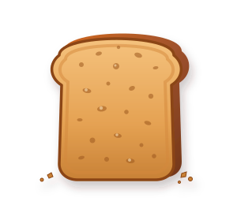

<p align="center">
  
</p>

<h1 align="center">Rusk</h1>

<p align="center"><strong>An English-like language that bakes ahead of time.</strong></p>

A rusk is bread baked twice so it keeps for months. Rusk the language works the
same way: the compiler does the hard work up front, and what ships is a
standalone native executable with no runtime and no dependencies.

```rusk
say "Hello, world."
```

```console
$ rusk build hello.rk
baked hello.rk -> hello (3.1 KB, native aarch64, 0 dependencies)
$ ./hello
Hello, world.
```

That binary is a static ELF file containing hand-encoded AArch64 or x86-64
machine code, chosen when you bake. No C, no LLVM, no assembler, no linker, no
libc — the program talks to the kernel through `write(2)` and `exit(2)`
syscalls.

## Status

v1.2.1 adds `fastlib/simple`, a native GUI library written in Rusk. A small set
of GUI primaries creates real Win32 windows, buttons, labels, and fields on
Windows x86-64; the rest of the library — geometry, events, dialogs, themes,
menus, layouts, and text helpers — is ordinary `.rk` code under `fastlib/`. On
Linux and AArch64 the same source checks and bakes with the GUI primaries as
safe no-ops. See [Simple GUI library](#simple-gui-library).

v1.2.0 is the debugging-and-errors release. The prompt colours Rusk code as
you type it, moves by word with Ctrl/Alt+Left and Ctrl/Alt+Right, and has a
built-in `rdb` debugger: `:rdb [file.rk]` or `rusk rdb [file.rk]` steps
top-level statements, with breakpoints, step/continue, `list`, `where`, and
`print NAME`. Mistakes now get numbered codes (`E01`, `E02`, …), a category,
the line, an explanation, and a `Do you want to edit this code using the REPL
y/n` question that reopens the offending code with the cursor ready. Windows
packages ship [`assets/rusk-logo.svg`](assets/rusk-logo.svg); `rusk logo`
prints that SVG on Windows and the ASCII wordmark elsewhere.

v1.1.7 is a Windows-focused patch on v1.1.6. The experimental Windows x86-64
target now parses the command line into `all arguments` and `argument N` (up to
1024 words, with everyday double-quote rules), reads the environment through
`GetEnvironmentStringsA`, reads and writes regular files through
`CreateFileA`/`ReadFile`/`WriteFile`/`CloseHandle`, and turns raw terminal mode
on and off through `GetConsoleMode`/`SetConsoleMode`. Directories, process
launch, and sockets still stop with the unsupported-feature message.

v1.1.6 was the toast-and-Windows-milestone release. `rusk toast` bakes a
program once into a portable `.tst` **toast file**, and `rusk run`, `rusk build`
and `rusk check` understand that file without the source. A toast can hold both
Linux architectures, **AArch64 and x86-64**, and also an experimental
**Windows x86-64** image that `rusk build --target windows` wraps into a PE32+
`.exe`. The Windows target started as a first, honest milestone: console output
and input, process exit, and a `VirtualAlloc` heap worked; most system calls did
not.

v1.1.4 was the networking-and-terminal release. v1.1.5 was a small patch on
it that fixed large heap growth and directory listing on AArch64 under
emulation. Programs
can open IPv4 TCP connections with `connect to HOST at PORT`, listen with
`listen at PORT`, accept with `accept from LISTENER`, exchange text with
`send`, `read line from`, and `read all from`, and close descriptors with
`close`. They can also put standard input into raw mode with `turn on raw
terminal`, read one byte at a time with `read key`, and restore the terminal
with `turn off raw terminal`; normal exit and `stop with` restore it
automatically. v1.1.3 added the systems core: directory operations,
`run command`, `all arguments`, a growable `mmap`-backed heap with a free
list, and the 128-parameter limit.

v1.1 makes functions first-class: **function-typed parameters**, **function
values in lists**, **functions that give back functions**, and closures that
can do all three. A kind such as
`a function taking a number giving back a number` can now name a parameter or
a list item, and `a function with ...:` is an ordinary expression. Functions
can also read and change the top-level names around them.

The backends grew up too. The x86-64 encoder now keeps values in real registers
inside each straight-line block instead of round-tripping every virtual
register through memory, and the writable data area is placed after the final
text size rather than at a fixed address, so big programs no longer collide
with their own data.

Files can also be joined directly: `export "other.rk"` includes another
file's content or chosen functions, and a line containing only `end` or `<e>`
closes a file so chained sources do not run into each other.

The compiler is a lexer, parser, import expander, type checker, ownership
checker, target-selecting code generator, two machine-code backends, a toast
container, and ELF or PE32+ writers, with **284 tests**. The end-to-end suite
also runs against x86-64 under QEMU. It bakes **Linux executables for AArch64
and x86-64**, **experimental Windows x86-64 executables**, and portable toast
files, and the compiler itself runs on Linux or on Windows x86-64.

On Windows, `rusk build`, `rusk check`, and both REPL modes work. `rusk run`
reports that the baked Linux ELF cannot execute natively; build the program and
run it under WSL or on a Linux machine, use `--target aarch64`/`x86_64` for
cross-baking, or use `--target windows` to produce a `.exe`. The Windows output
is experimental and documented below.

The first self-hosting step also lives in the tree: `selfhost/interpreter.rk`
is an integer-expression interpreter written in Rusk and compiled by Rusk. See
[Self-hosting](#self-hosting).

## Quick start

```console
cargo build --release
cargo run --                              # run a nearby Ruskfile, else the session
cargo run -- run examples/hello.rk       # bake and run
cargo run -- run examples/closures.rk    # function values and views
cargo run -- tui                          # start the full-screen session
cargo run -- tui demo                     # try the terminal module demo
cargo run -- build examples/loop.rk      # write ./examples/loop
cargo run -- build examples/hello.rk --target x86_64  # cross-bake
cargo run -- check examples/numbers.rk   # bake without writing anything
cargo run -- toast examples/hello.rk     # write a portable hello.tst
cargo run -- build examples/hello.rk --target windows  # write hello.exe (experimental)
```

Or install the `rusk` binary from `target/release/` somewhere on your `PATH`.

The curl-friendly installer, `toastset`, fetches a prebuilt release. Running it
again upgrades an existing installation in place:

```console
curl --proto '=https' --tlsv1.2 -sSf \
  https://raw.githubusercontent.com/Rusk-programing-language/Rusk/main/toastset | sh
```

```console
sh toastset --version 1.2.1
sh toastset --target aarch64-unknown-linux-musl
sh toastset --bin-dir "$HOME/.local/bin"
```

On Termux and other musl-based systems (including Alpine), `toastset` picks the
statically linked musl build automatically; the same static build also runs on
ordinary glibc Linux. Downloads show a progress bar in a terminal, and running
the script again upgrades the installed copy in place.

On Windows, run the same command from Git Bash, MSYS2, or Cygwin. `toastset`
installs `rusk.exe`, adds its bin directory to your shell profile, and updates
the Windows user `PATH` through PowerShell, so new terminals find `rusk`
without any manual setup. It then asks `Add Rusk to the Windows Startup folder
so the prompt opens at login? [y/N]` before creating `Rusk.lnk` in your personal
Startup folder; the shortcut points at the installed executable, so upgrades
keep working. Answering `n` skips it, and `--no-startup` (or
`TOASTSET_NO_STARTUP=1`) skips the question entirely. `toastset --uninstall`
removes the shortcut as well. Pass `--no-modify-path` (or
`TOASTSET_NO_MODIFY_PATH=1`) to leave profiles alone, or `--bin-dir` to choose
the directory yourself. A plain PowerShell or `cmd.exe` session has no `sh`, so
use Git Bash, MSYS2, or Cygwin for the installer.

If you do not want Git Bash, paste this into a normal PowerShell window on
Windows 10 or 11. It asks GitHub for the latest release, downloads the Windows
build with `curl.exe`, unpacks it with `tar.exe`, and adds it to your user
`PATH`:

```powershell
[Net.ServicePointManager]::SecurityProtocol = [Net.SecurityProtocolType]::Tls12
$tag = (Invoke-RestMethod 'https://api.github.com/repos/Rusk-programing-language/Rusk/releases/latest').tag_name
# To pin a release instead of taking the latest, replace the line above with:
# $tag = 'v1.2.1'
$version = $tag.TrimStart('v')
$asset = "rusk-$version-x86_64-pc-windows-msvc.tar.gz"
$dest = Join-Path $env:LOCALAPPDATA 'Rusk'
$tarball = Join-Path $env:TEMP $asset

New-Item -ItemType Directory -Force $dest | Out-Null
curl.exe -fsSL "https://github.com/Rusk-programing-language/Rusk/releases/download/$tag/$asset" -o $tarball
tar.exe -xzf $tarball -C $dest --strip-components 1
Remove-Item $tarball

$userPath = [Environment]::GetEnvironmentVariable('Path', 'User')
if (-not $userPath) { $userPath = '' }
if ($userPath -notlike "*$dest*") {
    [Environment]::SetEnvironmentVariable('Path', ($userPath.TrimEnd(';') + ";$dest"), 'User')
}
$env:Path = "$env:Path;$dest"
rusk version
```

(`curl.exe` and `tar.exe` ship with Windows 10 version 1803 and newer. The
installer script itself still needs a POSIX shell, which is why this PowerShell
path downloads the release directly.)

## Toast files and experimental Windows output

`rusk toast` bakes a program once and stores the finished images in a `.tst`
container, called a **toast file**. It is not source and not a linker: it holds
the machine code, read-only data, zeroed-data size, and Windows import names
for each target. A toast defaults to both Linux architectures:

```console
$ rusk toast hello.rk
toasted hello.rk -> hello.tst (34.2 KB, aarch64, x86_64, 0 dependencies)
$ rusk check hello.tst
hello.tst is an intact toast (aarch64, x86_64, source hello.rk, built with rusk 1.2.1)
  aarch64: 6.8 KB code, 355 B data, 1088.2 KB zeroed
  x86_64: 25.8 KB code, 355 B data, 1088.2 KB zeroed
$ rusk run hello.tst             # runs the host image
$ rusk build hello.tst -o hello  # wraps the host image back into a native executable
```

Use `--target aarch64`, `--target x86_64`, `--target windows`, or repeat
`--target` to choose the images. `--target all` means both Linux targets. A
`.tst` is ordinary data, not an executable, and its FNV-1a checksum catches
truncation and accidental damage; it is an integrity check, not a signature.

The experimental Windows target writes a PE32+ `.exe` with imports from
`kernel32.dll`:

```console
$ rusk build hello.rk --target windows
baked hello.rk -> hello.exe (29.0 KB, native windows-x86_64, 0 dependencies)
```

`rusk run --target windows` is refused because a Linux host cannot execute a PE
file. The `.exe` is still experimental, not parity. It reads and writes the
console, exits with a status, backs the heap with `VirtualAlloc`, parses the
command line (up to 1024 words, with double quotes grouping words), reads the
environment, reads and writes regular files, and switches the console between
raw and normal input. Directory calls, process launch, and sockets print
`burnt: this Windows build does not support that feature yet` and exit 1. The
image is fixed-base with no base relocations. Treat it as an experimental way
to run small console programs, not as a second supported platform yet.

The toast layout is documented in [docs/SPEC.md](docs/SPEC.md): magic
`RTOAST1\n`, version 1, per-image records, and the trailing checksum.

## A taste of the language

```rusk
# variables
let temperature be 180
set temperature to temperature + 5

# English comparisons
if temperature is more than 150:
    say "Too hot. The crust will burn."
otherwise:
    say "Just right."

# loops
repeat 3 times:
    say "one loaf"

while temperature is more than 150:
    say "cooling..."
    set temperature to temperature - 20

for each slice from 1 to 3:
    say slice

# break leaves the loop; continue jumps to the next turn
for each slice from 1 to 5:
    if slice is 3:
        continue
    if slice is 5:
        break
    say slice

# arithmetic and truth
say (10 - 4) * 2
say 100 / 3
say temperature is at least 180
say not false
say true and not false
say 1 is less than 2 or 2 is less than 1

# text joins with `+` and compares like a dictionary
let name be "Rusk"
say "Hello, " + name + "!"
if name is "Rusk":
    say "the crust is on"

# measure, index, and slice text; positions count from 1
say length of name            # 4
say letter 1 of name          # R
say part 2 to 3 of name       # us
say "Hello, " + letter 1 of "world" + "!"
```

Lists hold one kind of thing, count from 1, and can be walked directly:

```rusk
constant batch_size be 12

let loaves be [3, 6, 9]
say length of loaves          # 3
say item 2 of loaves          # 6
set item 2 of loaves to batch_size
say loaves                    # [3, 12, 9]

let names be ["rye", "wheat"]
for each name in names:
    say "one " + name + " loaf"
add "spelt" to names
say names                     # [rye, wheat, spelt]
remove last from names
say names                     # [rye, wheat]
remove item 1 from names
say names                     # [wheat]

let empty be an empty list of numbers
say empty                     # []
```

Text and lists are owned. Giving one a second name moves it, and the compiler
rejects any later use of the old name — so there is never a dangling name,
a double free, or two writers racing over one value. When a function only needs
to read a value, borrow it as a **view** instead:

```rusk
to total with xs as a view of a list of numbers:
    let sum be 0
    for each x in xs:
        set sum to sum + x
    give back sum

let loaves be [3, 6, 9]
say total with loaves         # 18; loaves was not moved
say length of loaves          # 3
```

A view is shared read-only: it can be read, indexed, iterated, and passed on,
but not changed, moved, or used as the owner. `copy of` makes an independent
value.

```rusk
let words be ["rye", "wheat"]
let mine be copy of words     # `copy of` makes an independent list
say words                     # [rye, wheat]
say mine                      # [rye, wheat]

let greeting be "hello"
let echoed be greeting        # this moves greeting
say echoed                    # hello

# say greeting                # compile error: greeting was moved

constant motto be "bake twice"
let sign be copy of motto     # constants are read-only; copy them
say sign
```

Numbers and truth values are plain machine words, so they are copied freely
and never move. The rule is checked before code generation, not at runtime.

Top-level names are visible inside functions. A function may read a global and
change it with `set` or `add`; it cannot move it, because the top level keeps
owning it. A local name can shadow a global:

```rusk
let total be 0

to bump with n as a number:
    set total to total + n

bump with 2
bump with 3
say total                     # 5
```

Programs can talk to the system without a library:

```rusk
say number of arguments       # arguments after the program's own name
say argument 1                # empty text when there is no such argument
say environment "HOME"        # empty text when the variable is unset

let name be read line         # one line, without its newline
let rest be read all input    # everything left on standard input
let notes be read file "notes.txt"
write "baked fresh" to file "loaf.txt"

warn "using the spare oven"   # standard error, with a newline
stop with 2                   # choose the process exit status
```

`read file` and `write ... to file` use the path as written. A missing or
unreadable file, or a path too long for the runtime scratch area, is reported
as a Rusk error. `rusk run file.rk one two` passes `one` and `two` through to
`argument 1` and `argument 2`.

The systems surface adds IPv4 TCP and raw terminal input:

```rusk
let server be listen at 8080
let client be connect to "127.0.0.1" at 8080
let peer be accept from server

send "fresh bread\n" to client
say read line from peer

close peer
close client
close server

turn on raw terminal
let key be read key
turn off raw terminal
```

Sockets and listeners are ordinary numbers (file descriptors), or `-1` when a
call fails. `send` writes every byte, `read line from` drops the newline, and
`read all from` runs to end of stream. Raw mode is restored on normal exit, on
`stop with`, and on a runtime error; on a pipe it is simply ignored, so the
same program still runs under redirection.

A file can pull in several modules; each file is included at most once:

```rusk
import "lib/greetings"          # plain inclusion, global names
import "math"                   # math_square, ...

import "lib/units" as units     # units.convert, units.ratio, ...
from "lib/text" import trim     # trim, without a prefix
from "lib/text" import pad as pad_left

export "lib/greetings"          # include all of it as this file's content
export double from "lib/math"   # include just one function
export double, trim             # declare exported names

say greeting with "world"
say math_square with 12
say units.convert with 3
say pad_left with "x"
```

A bare module name is resolved next to the importing file, then in `ruskmods/`,
`rusklib/`, and `fastlib/` beside it and in each parent directory. That means
`import "math"` works from a program at the checkout root and from one in
`examples/`, `import "wheat/table"` finds `rusklib/wheat/table.rk`, and
`import "simple/simple"` finds `fastlib/simple/simple.rk`.

The checkout ships small Rusk libraries under `ruskmods/`: `math`, `date`,
`time`, `random`, `statistics`, `json`, `toml`, `sys`, `os`, `path`, and
`shutils`. `ruskmods/installwork/` is an installer framework with a registry,
version specs, a dependency resolver, archives, an install prefix, and a CLI.
The `rusklib/` folder adds higher-level file and archive helpers, the `wheat`
terminal UI library, and a bundle that imports everything. `fastlib/` holds
libraries built on language primaries, starting with the `simple` GUI:

```rusk
import "rusklib/rusklib"
say date_format_iso with 2026 and 11 and 12
say files_exists with "notes.txt"
say wheat_box_around with "hello" and 0 and "rounded"
```

Every public name carries its module's prefix (`date_`, `files_`, `wheat_`,
`simple_`, and so on) because a plain import shares one global namespace. Import
one module directly when a program does not need the bundle. See
[`ruskmods/README.md`](ruskmods/README.md),
[`rusklib/README.md`](rusklib/README.md), and
[`fastlib/README.md`](fastlib/README.md) for the function lists.

A line containing only `end`, `end.`, `<e>`, `</e>`, or `end of file` stops the
file there, so chained or concatenated files do not run into each other. That
also lets `export` stop at the other file's own boundary.

Functions name a piece of work and can hand a value back:

```rusk
to double with n as a number:
    give back n * 2

to greet with who as text:
    say "Hello,"
    say who

to roll:
    say "rolling..."

say double with 21        # 42
greet with "world"
roll                      # a zero-argument call is just the name

to factorial with n as a number:
    if n is at most 1:
        give back 1
    give back n * factorial with n - 1

say factorial with 5      # 120
```

Parameters declare their kind (`a number`, `text`, `a truth value`). What a
function gives back is **inferred** from its `give back` lines, including
through recursion. A function with no `give back` gives nothing back and
cannot be used as a value.

Functions can also be values, and a function value can remember the world where
it was made:

```rusk
let twice be the function double
say call twice with 21        # 42
say twice with 4              # the ordinary call spelling works too

let base be 10
let add_base be a function with n as a number:
    give back n + base

say call add_base with 5      # 15
```

A function written with `a function with ...:` is a **closure**: it captures
the names around it. Numbers and truth values are copied into the closure; text
and lists are captured as shared read-only views, so the closure can read them
but not move or change them.

Kinds can describe functions, so functions can be passed, listed, and given
back:

```rusk
to apply with f as a function taking a number giving back a number and n as a number:
    give back call f with n

to twice with n as a number:
    give back n * 2

say apply with the function twice and 21      # 42

let steps be [the function twice]
add a function with n as a number:
    give back n + 1
to steps
say call (item 2 of steps) with 41            # 42
```

Two function parameters are separated by a comma:
`a function taking a number, text giving back a truth value`. A function with
no parameters is `a function giving back a number`. A list of functions is
`a list of functions taking ... giving back ...`, which also works with
`an empty list of functions ...`.

Function values may be stored, copied with `copy of`, put in lists, printed
(`<function>`), and given back. They still cannot be compared. A dynamic call
checks both the number of arguments and their kinds.

Files and directories are ordinary statements and expressions:

```rusk
make directory "notes"
write "hello" to file "notes/today.txt"

say file exists "notes/today.txt"      # true
say list directory "notes"             # [today.txt]

rename "notes/today.txt" to "notes/old.txt"
remove file "notes/old.txt"
remove directory "notes"

say run command "echo from the shell"  # prints, then 0
say run command "exit 3"               # 3
```

`make directory` treats an existing directory as success, and `remove file` /
`remove directory` ignore a path that is already gone. `run command` hands its
text to `/bin/sh -c` and gives back the exit status. Command-line arguments are
available one at a time with `argument N` and all at once with `all arguments`:

```rusk
for each arg in all arguments:
    say arg
```

Everything is line-based, blocks are colon-plus-indentation, and `#` starts a
comment. Full reference: [docs/SPEC.md](docs/SPEC.md). A hands-on tour lives in
the [guide](guide/README.md).

## Simple GUI library

v1.2.1 ships [`fastlib/simple`](fastlib/simple/README.md), a small native GUI
library written in Rusk. Its `core.rk` uses a handful of GUI primaries; the
other thirty modules are ordinary `.rk` files for geometry, events, dialogs,
layouts, themes, and text. Import the whole bundle or just one file:

```rusk
import "simple/simple"

let window be simple_window with "Hello" and 320 and 200
let button be simple_button with window and "Press" and 10 and 10 and 100 and 30
simple_window_open with window
let running be true
while running:
    let event be simple_event_wait
    if event is "close":
        set running to false
    if event is "click":
        if (simple_event_id) is button:
            simple_control_set_text with button and "Thanks"
simple_window_exit
```

Bake a GUI program for Windows x86-64:

```console
rusk build app.rk --target windows -o app.exe
```

The window and controls are real Win32 objects. The PE still imports only
`kernel32.dll`; `user32.dll` functions are resolved at runtime with
`LoadLibraryA` and `GetProcAddress`. Events (`""`, `click`, `change`, `close`)
are recorded by a hand-emitted `WndProc` and read by the Rusk loop, so there are
no language callbacks. On Linux and AArch64 the same GUI syntax checks and
bakes as safe no-ops. Native support is currently buttons, labels, fields,
message boxes, and confirm boxes; frames, menus, canvases, and drag-and-drop
are Rusk-level models. See the
[`simple` README](fastlib/simple/README.md) for every module and primary.

## The prompt

`rusk` with no arguments runs a nearby `Ruskfile` if it finds one, and otherwise
starts the interactive session. `rusk repl` always starts the session:

```console
$ rusk
░█▀▄░█░█░█▀▀░█░█
░█▀▄░█░█░▀▀█░█▀▄
░▀░▀░▀▀▀░▀▀▀░▀░▀

Rusk 1.2.1 — an English-like language
Type :help for commands, :quit to leave.

rusk> let who be "world"
rusk> "Hello, " + who + "!"
Hello, world!
rusk> to double with n as a number:
...       give back n * 2
...
rusk> double with 21
42
```

Names and functions survive between lines. A bare expression shows its value,
the way Python's prompt does; `let`, `set`, `say`, and definitions stay quiet.
A line ending in `:` opens a block, and a blank line closes it. The session
uses the same lexer, parser, and type checker as the compiler, and text
positions count bytes just like a baked program.

```text
:help            show the commands
:quit            leave the session
:reset           forget every name and function
:vars            show the names the session remembers
:functions       show the functions the session remembers
:load <file.rk>  run a file in the session
:rdb [file.rk]   step through a file, or the last code you ran
:step            rdb: run one top-level statement
:continue        rdb: run to the next breakpoint or the end
:break N         rdb: stop before line N
:delete N        rdb: remove a breakpoint ('delete all' clears them)
:breaks          rdb: list breakpoints
:list [N]        rdb: show source around N
:where           rdb: show the current file, line, and step
:print NAME      rdb: show a name the program has made
:repl            leave rdb
```

On a terminal the prompt colours keywords, text, numbers, comments, names, and
operators as the line is typed. Arrows move one character; Ctrl/Alt+Left and
Ctrl/Alt+Right move one word. Home/End jump, Up/Down recall history, Tab inserts
four spaces, and Ctrl-C, Ctrl-U, Ctrl-K, Ctrl-W, and Ctrl-L edit the line.

Mistakes are printed as `E01`, `E02`, … with the kind of error, the line, the
source, a hint, and the question `Do you want to edit this code using the REPL
y/n`. Answering `y` puts that code back at the prompt with the cursor ready.
The same report is used by `rusk build`, `rusk run`, and `rusk check`; over a
pipe the question is skipped.

`rdb` works one **top-level statement** at a time. Function definitions run as
one step, and calls inside them are not stepped into yet. Without the colon,
the same words work at an `(rdb)` prompt: `step`, `continue`, `break N`,
`delete N`, `breaks`, `list`, `where`, `print NAME`, `vars`, `functions`,
`load FILE`, and `quit`. `rusk rdb file.rk` starts that prompt from a shell.
`rusk logo` prints the ASCII wordmark on Unix and the bundled SVG logo on
Windows.

Piped input skips the banner and prompts, so `rusk < program.rk` works too.

`rusk tui` starts the same session in a full-screen interface. It keeps the
transcript, input line, history, and `:commands` on one screen, with the
banner, expression results, multi-line blocks, and errors scrolling above the
prompt. Editing supports arrows, Home/End, Delete, Page Up/Down, and UTF-8;
Up/Down recall earlier lines, Ctrl-C cancels the current line or block, Ctrl-L
clears the transcript, and Ctrl-D leaves. It puts the terminal into raw mode
through `termios`, draws ANSI frames, notices window resizes, and restores the
terminal on the way out — including when a program uses `stop with`.
`rusk tui demo` opens the smaller terminal-module demo instead. There is no
`crossterm` or `ratatui`; over a pipe both commands fall back to plain text
instead of escapes.

## Projects and the Ruskfile

A `Ruskfile` is a project manifest **and** a task runner in ordinary Rusk
source. There is no TOML file and no second language to learn:

```rusk
# Ruskfile
let package_name be "demo"
let package_version be "1.2.0"
let package_entry be "src/main.rk"
let package_description be "A tiny demo"
let package_license be "MIT"
let package_requires be ["math >=1.0.0", "text ^2.1.0"]

to build:
    say run command "rusk build src/main.rk -o bin/demo"

to test:
    say run command "rusk run tests/main.rk"

build
```

The `let package_...` lines are metadata read by the installer; everything else
is an ordinary program. Running `rusk` with no arguments searches the current
directory and its parents for `Ruskfile` (then `ruskfile`) and runs the first
one it finds. The `installwork` framework in `ruskmods/installwork/` reads the
manifest, resolves requirements, and installs a package tree into a prefix.
Its CLI also lists tasks and writes a starter project:

```console
installwork tasks
installwork init demo
installwork plan demo
installwork install demo
```

The registry is a local directory tree of package versions; there is no server.

## How it works

```text
.rk source
   │
   ▼
 imports    expand each file once, recursively
   │
   ▼
 lexer      tokens (+ Indent/Dedent markers)
   │
   ▼
 parser     AST, recursive descent, English operators
   │
   ▼
 types      kinds and return-kind inference
   │
   ▼
ownership   one owner per text value and list
   │
   ▼
 codegen    AArch64 or x86-64 machine code
   │
   ▼
 elf        ELF64 header + one PT_LOAD + your code
   │
   ▼
 executable
```

| File | Job |
|---|---|
| `src/imports.rs` | Find files, expand plain/named/selective imports, detect cycles, include once |
| `src/lexer.rs` | Source to tokens; keywords are plain words matched by the parser |
| `src/highlight.rs` | Source colouring for the interactive editor |
| `src/editor.rs` | Raw-mode line editing and word movement at the prompt |
| `src/diagnostics.rs` | Numbered, explained errors and the edit-after-error question |
| `src/debugger.rs` | `rdb` stepper, breakpoints, and source listing |
| `src/logo.rs` | The bundled SVG logo and the platform wordmark |
| `src/parser.rs` | Recursive descent over the English grammar |
| `src/types.rs` | Type checking and return-kind inference (fixed point) |
| `src/ownership.rs` | Flow-sensitive single-owner checking for text and lists |
| `src/codegen.rs` | AST to machine code; stack-machine expression evaluation, stack frames |
| `src/backend.rs` | Target selection and the common assembly interface |
| `src/aarch64.rs` | Hand-written AArch64 encoder and branch/address fixups |
| `src/x86_64.rs` | Hand-written x86-64 encoder with a register allocator for virtual registers |
| `src/elf.rs` | Static ELF64 executable writer for either target |
| `src/repl.rs` | Interactive session: tree-walking evaluator, line prompt, and full-screen loop |
| `src/tui.rs` | Native terminal UI: raw mode, ANSI frames, key decoding, resize fallback |
| `src/main.rs` | The `rusk` CLI |

Runtime facts worth knowing:

- Code starts at `0x400000 + 0x78`. The writable data area is placed on the
  next 4 KiB boundary after the text and read-only sections, so its address is
  computed at the end of code generation instead of being fixed. Top-level
  variables, the number buffer, file-path scratch space, the heap, and the
  x86-64 register homes all live in that data area.
- The code generator speaks one small virtual-register language: results come
  back in `X0`, arguments travel in one contiguous stack block pointed to by
  `X18`, and the frame pointer is `X29`. AArch64 uses those registers directly.
  x86-64 maps virtual registers onto a pool of six caller-saved physical
  registers inside each straight-line block, writes them back at labels,
  branches, calls, returns, and syscalls, and uses the real `rsp` for `SP`. Its
  home slots and every data address are patched once the text size is known.
  The return address lives on the process stack rather than in `X30`.
- Strings are stored as `[len: u64][bytes...]`, so a string value is just a
  pointer to its length. Joining two strings allocates from the heap and copies
  both byte blobs into it.
- The heap is a list of `mmap`-backed chunks. Each block has a 16-byte header
  (`size`, `next free`), allocation walks the free list before bumping the
  current chunk, and freed list or input buffers go back on that list. When a
  chunk fills, another one is mapped, so memory grows with the program. Growth
  stops at 1 GiB of mapped chunks; a program that asks for more reports
  `burnt: the program ran out of memory`.
- Lists are stored as `[len: u64][capacity: u64][item: i64]...` in that heap.
  A list value is a pointer, but the ownership checker allows only
  one live name for it, so `let b be a` moves the list and `copy of a` makes a
  new one. Nested lists are pointers too; `copy of` and `say` use recursive
  routines that the code generator emits once per list shape. Item and bounds
  checks happen in the runtime helper `array_get` / `array_set`. `array_add`
  appends in place while the length is below the capacity; when it must grow it
  allocates a new block with at least four slots, or twice the old capacity,
  copies the items, and frees the old block. `array_remove_last` and
  `array_remove_at` shorten the list in place, shift later items left, and keep
  the capacity unchanged.
- Text compares byte by byte (unsigned), then by length, so `"b"` is more than
  `"abc"` and `"ab"` is less than `"abc"` — ordinary dictionary order. Lists do
  not compare yet.
- The kernel's initial stack pointer is saved at entry, so `argument N`,
  `all arguments`, and `environment NAME` can walk `argv` and `envp` directly.
  File paths are copied into a 4 KiB scratch area and NUL-terminated before
  `openat(2)`. Standard input and files are read with `read(2)`; files are
  written with `openat(2)`/`write(2)`/`close(2)`. Directories use
  `mkdirat(2)`, `unlinkat(2)`, `renameat(2)`, `getdents64(2)`, and
  `faccessat(2)`. `run command` forks with `clone(2)`, runs `/bin/sh -c`
  through `execve(2)`, and collects the status with `wait4(2)`.
- `say` of a number calls a hand-built itoa loop that divides by ten and writes
  digits backwards into a 32-byte buffer. Syscall numbers are translated per
  target: AArch64 `write`/`exit`/`read`/`openat`/`close` are
  `64`/`93`/`63`/`56`/`57`, and x86-64 uses `1`/`60`/`0`/`257`/`3`.
- Before code generation, `ownership` walks every path and rejects a use of a
  moved name. A move in one arm of an `if` counts as a move after it; a `give
  back` ends that path. `copy of` is the only way to duplicate an owned value.
- Runtime guards turn three machine-level failures into Rusk sentences on
  standard error with exit status 1: division by zero, heap exhaustion, and
  recursion deeper than 1000 calls.
- Everything is fixed-address and loaded by the kernel; there is no runtime
  relocation pass. Data addresses are patched into the finished machine code,
  so growing the text section moves the data instead of colliding with it.

## What v1.2.1 doesn't do yet

Honest list, so the docs don't lie:

- Text is immutable. Joining allocates from the heap and nothing is reclaimed
  automatically, though the heap now grows in chunks up to a 1 GiB cap instead
  of stopping at a fixed 1 MiB ceiling.
- Ownership is single-owner. A `view` lends a value read-only, but a view
  cannot be changed, moved, stored, or used where an owner is needed; `copy of`
  is still the escape hatch. Views do not extend a value's lifetime beyond the
  frame that owns it.
- Function values cannot be compared. Everything else about them is ordinary:
  they can be stored, copied, printed, listed, passed, and given back.
- Lists are homogeneous and may nest, but they cannot be compared. Their
  contents can be replaced with `set item`, `add VALUE to LIST` appends with
  spare capacity, and `remove last from LIST` / `remove item N from LIST`
  shorten them. Capacity never shrinks.
- System I/O now covers text files, standard streams, directories, shell
  commands, IPv4 TCP sockets, and raw terminal input. Networking is TCP only:
  there is no IPv6, UDP, DNS, TLS, timeout, non-blocking mode, or half-close.
  A host name other than a numeric dotted address is treated as `127.0.0.1`
  (that includes `localhost`). Socket calls are blocking, `send` ignores a
  failed write, and reading from a bad descriptor gives empty text.
- Raw mode changes standard input only and does not decode keys: arrow keys
  arrive as their escape bytes. A pipe is left alone, so the same program still
  runs under redirection.
- There are still no threads, signals, or random-access file positions. A path
  is limited by the 4 KiB scratch area.
- Imports and exports have plain, named, and selective forms. There are no
  package manifests or a standard module registry.
- Text positions count bytes, not Unicode characters.
- At most 128 parameters per function. There is no overloading.
- Linux is the supported platform, on AArch64 or x86-64. Windows x86-64 output
  is experimental and console-only: it covers standard I/O, exit, the heap,
  arguments, environment, regular files, and raw terminal mode, but not
  directories, process launch, or sockets. There is no macOS, 32-bit, Windows
  GUI, or Windows service output. The compiler itself runs on Windows x86-64
  but cannot execute the Linux ELF it bakes; use `--target windows` for a
  `.exe`.
- Toast files are whole-program containers, not relocatable objects or a linker.
  They cannot be combined, patched, or linked with other code, and they carry
  no signature. A toast holds at most 8 target images.
- The `simple` GUI is deliberately small: native buttons, labels, fields, text
  messages, and yes/no boxes. Menus, frames, canvases, and drag-and-drop are
  Rusk-level models rendered into labels; native versions would need more
  primaries. pthread-style threads and a package registry are still later
  layers.
- The x86-64 register allocator works within straight-line blocks and spills at
  every branch and call. It is much closer to AArch64 than the old
  memory-backed encoder, but it is not a global allocator yet.
- The single load segment is RWX, which is convenient but not hardened.
- Self-hosting is an interpreter stage. The Rusk compiler itself is still
  written in Rust; `selfhost/interpreter.rk` runs a small integer-expression
  language, not all of Rusk.

## Self-hosting

`selfhost/interpreter.rk` is a Rusk program that interprets a small Rusk-like
language. It handles `let`, `set`, `say`, integer arithmetic, parentheses,
unary minus, and variables, and it is itself compiled by Rusk:

```console
cargo run -- run selfhost/interpreter.rk selfhost/demo.rk
```

```text
42
15
51
```

The interpreter is a real bootstrap step: every part of it — tokenising,
parsing, precedence, and evaluation — is written in Rusk and baked to a static
ELF with the same compiler that runs it. Full compiler self-hosting is the next
stage, not a claim of this release.

## What you can build

Rusk is aimed at small, self-contained Linux programs: command-line tools,
calculators, text and file filters, teaching examples, and experiments in
compiler and language design. v1.1.6 added portable toast files and an
experimental Windows x86-64 `.exe` target, and v1.1.7 extends that target to
arguments, the environment, regular files, and raw terminal mode, so Linux
console tools can be baked once and shipped as a `.tst`, and small Windows
console programs are now practical. A baked program is still at heart a single
static ELF with no runtime, so it is easy to copy to a server, container, or
Termux device.

It is a young language, and that limits the honest answer. Networking is
blocking TCP only, with no DNS, TLS, UDP, or IPv6, and there are still no
threads, GUI toolkit, or networked package registry. Windows output is
experimental. It is not ready for large applications, services, embedded
systems, or libraries that other languages call into. Treat it as a compact AOT
language for small programs, not as a general-purpose production platform yet.

## How it compares

- **C** — the closest comparison for small static binaries and direct machine
  code. Rusk trades C's ecosystem and portability for a smaller compiler and an
  English-like syntax; C is far more capable and battle-tested.
- **Go** — also compiles to a self-contained executable with a simple feel, but
  Go has a large standard library, concurrency, and a mature toolchain. Rusk is
  orders of magnitude smaller in scope.
- **Zig** — shares the "small compiler, no hidden runtime, own backend" ethos.
  Zig is a serious systems language with broad targets; Rusk is a teaching- and
  experiment-sized language with two Linux targets.
- **Python, Lua, and shell** — similar beginner-friendly readability, but those
  are interpreted or scripted. Rusk's difference is ahead-of-time machine code
  and a dependency-free output binary.
- **Rust** — shares the name's bakery joke, not the goals. Rust is a
  full systems language with safety guarantees and a huge ecosystem; Rusk is
  deliberately tiny and much less safe.

The fair summary: Rusk competes on *simplicity and tiny static output* with
teaching languages and small CLI tools. It does not yet compete with C, Go, Zig,
or Rust on capability, libraries, or production readiness.

## Why the name

Rusk is twice-baked bread: prepared ahead of time, shelf-stable, and it keeps.
Rust's compiler is `cargo`; Rusk's vocabulary leans into the bakery (`oven` for
the build tool, `loaf` for a package) — none of that exists yet, but the door is
open.

> Rusk is not Rust. It's an English-like AOT language that happens to be one
> letter away.

## Logo

The official Rusk mark lives in
[`assets/rusk-logo.svg`](assets/rusk-logo.svg). Its full source:

```svg
<svg xmlns="http://www.w3.org/2000/svg" viewBox="0 0 300 260" width="300" height="260">
  <defs>
    <!-- Crust gradient -->
    <linearGradient id="crustGrad" x1="0%" y1="0%" x2="100%" y2="100%">
      <stop offset="0%" stop-color="#D2691E" />
      <stop offset="50%" stop-color="#A0522D" />
      <stop offset="100%" stop-color="#703518" />
    </linearGradient>

    <!-- Golden baked interior gradient -->
    <linearGradient id="crumbGrad" x1="0%" y1="0%" x2="0%" y2="100%">
      <stop offset="0%" stop-color="#F5C27D" />
      <stop offset="60%" stop-color="#E5A253" />
      <stop offset="100%" stop-color="#C88136" />
    </linearGradient>

    <!-- Soft drop shadow -->
    <filter id="dropShadow" x="-10%" y="-10%" width="130%" height="130%">
      <feDropShadow dx="4" dy="8" stdDeviation="6" flood-color="#3E2723" flood-opacity="0.25" />
    </filter>
  </defs>

  <!-- Main Rusk Group -->
  <g filter="url(#dropShadow)" transform="translate(15, 10)">
    <!-- 3D Side Thickness / Crust -->
    <path d="M 65 55 
             C 65 25, 215 25, 215 55 
             C 228 65, 228 85, 212 95 
             L 215 195 
             C 215 208, 205 215, 192 215 
             L 88 215 
             C 75 215, 65 208, 65 195 
             L 68 95 
             C 52 85, 52 65, 65 55 Z" 
          fill="url(#crustGrad)" />

    <!-- Front Toasted Face -->
    <path d="M 60 60 
             C 60 32, 205 32, 205 60 
             C 218 70, 218 88, 202 98 
             L 205 198 
             C 205 210, 195 218, 182 218 
             L 83 218 
             C 70 218, 60 210, 60 198 
             L 63 98 
             C 47 88, 47 70, 60 60 Z" 
          fill="url(#crumbGrad)" 
          stroke="#8B4513" 
          stroke-width="3.5" 
          stroke-linejoin="round" />

    <!-- Subtle inner toast browning -->
    <path d="M 68 65 
             C 68 42, 197 42, 197 65 
             C 207 73, 207 86, 194 94 
             L 197 192 
             C 197 202, 190 209, 179 209 
             L 86 209 
             C 75 209, 68 202, 68 192 
             L 71 94 
             C 58 86, 58 73, 68 65 Z" 
          fill="none" 
          stroke="#D4883B" 
          stroke-width="4" 
          opacity="0.5" />

    <!-- Porous Air Pockets / Crumb Texture -->
    <g fill="#9C571D" opacity="0.55">
      <!-- Top dome pores -->
      <ellipse cx="110" cy="58" rx="4" ry="2.5" transform="rotate(-15 110 58)" />
      <circle cx="135" cy="50" r="2.2" />
      <ellipse cx="160" cy="60" rx="5" ry="3" transform="rotate(20 160 60)" />
      <circle cx="88" cy="72" r="3" />
      <ellipse cx="182" cy="76" rx="3.5" ry="2" transform="rotate(-10 182 76)" />
      <circle cx="132" cy="74" r="4" />
      
      <!-- Middle pores -->
      <ellipse cx="95" cy="105" rx="5.5" ry="3" transform="rotate(12 95 105)" />
      <circle cx="122" cy="96" r="2.5" />
      <ellipse cx="152" cy="102" rx="4" ry="2.8" transform="rotate(-25 152 102)" />
      <circle cx="176" cy="112" r="3.2" />
      <ellipse cx="114" cy="128" rx="6" ry="3.5" transform="rotate(-8 114 128)" />
      <circle cx="145" cy="132" r="2.8" />
      <ellipse cx="86" cy="142" rx="3.5" ry="2" />
      <ellipse cx="172" cy="146" rx="4.5" ry="2.5" transform="rotate(18 172 146)" />

      <!-- Bottom pores -->
      <circle cx="102" cy="168" r="3.5" />
      <ellipse cx="134" cy="162" rx="5" ry="2.8" transform="rotate(10 134 162)" />
      <circle cx="164" cy="174" r="2.5" />
      <ellipse cx="88" cy="190" rx="4" ry="2.2" transform="rotate(-15 88 190)" />
      <circle cx="120" cy="192" r="3" />
      <ellipse cx="150" cy="194" rx="5.5" ry="3" transform="rotate(5 150 194)" />
      <circle cx="180" cy="188" r="2.8" />
    </g>

    <!-- Lighter highlights inside larger pores for depth -->
    <g fill="#FCE2B8" opacity="0.6">
      <circle cx="131" cy="73" r="1.5" />
      <circle cx="94" cy="104" r="2" />
      <circle cx="113" cy="127" r="2.2" />
      <circle cx="133" cy="161" r="1.8" />
      <circle cx="149" cy="193" r="2" />
    </g>

    <!-- Loose Crunchy Crumbs Around Base -->
    <g fill="#C88136" stroke="#8B4513" stroke-width="1">
      <polygon points="45,212 50,209 52,214 47,216" />
      <circle cx="38" cy="218" r="2" />
      <polygon points="215,210 221,208 220,214 214,215" />
      <circle cx="226" cy="217" r="2.5" />
      <circle cx="212" cy="221" r="1.5" />
    </g>
  </g>
</svg>
```

## License

MIT.
